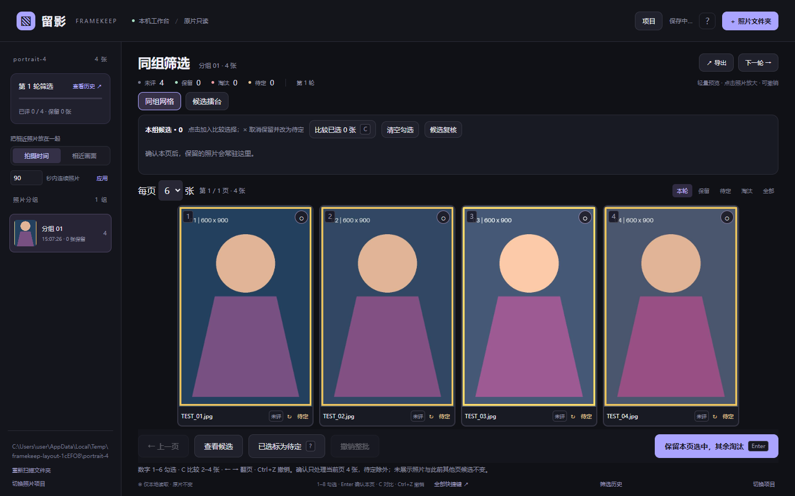
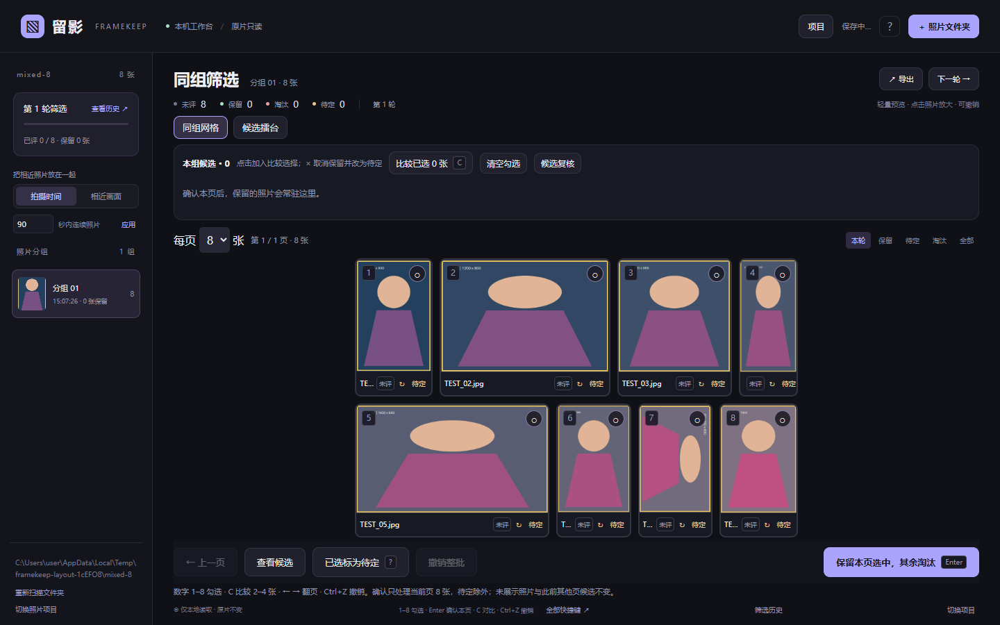

# 留影 FRAMEKEEP 2.2.0 · 本机照片筛选

从照片文件夹直接读取 Sony ARW 和常见图片。默认用同组多图网格快速筛选，保留跨页候选，再用 2–4 张大图对比检查细节。筛选进度保存在本机，导出直接复制保留的源文件。

代码仓库：[M74520/framekeep](https://github.com/M74520/framekeep)。下载源码 ZIP 后解压，双击 Windows 启动文件即可运行。

## 2.2.0 自适应横竖排版

照片卡片按实际宽高自动排列：竖图使用窄而高的卡片，横图使用宽卡片。每页仍可选 4 / 6 / 8 张，但行数不再固定；根据当前照片数量、比例和窗口空间，自动安排 1–3 行，完整显示构图，减少固定卡片产生的黑边。

本机预览已校正 EXIF 方向，布局直接使用校正后的宽高；预览加载后也会读取实际尺寸。照片的拍摄顺序和数字键编号不会因为排版而改变。

卡片底部的 `↻` 每次顺时针旋转 90°。旋转后立即重新排版，Ctrl+Z 可撤销，关闭重开可恢复；精细比较会使用相同旋转。旋转仅保存在留影项目的显示设置中，不改写源照片，也不改变导出原片的内容。





## 2.1.0 网格改版

- 默认每页 4 张，可切换 6 / 8 张；点击照片或数字 1–8 勾选，可以多选。
- Enter 确认：本页选中标为保留，本页其余标为淘汰；已经标为待定的照片除外。未显示的照片和其他页候选不受影响。
- 每页顺序固定，淘汰不会让后页照片前移而漏看。Ctrl+Z 一次恢复整页判断、候选和页码；按住 Enter 不会连续确认多页。
- 本组候选栏跨页常驻。点候选缩略图加入比较选择，× 取消保留并改为待定；“清空勾选”只清除比较选择，不改变判断。
- 勾选 2–4 张，按 C 打开精细比较。支持同步缩放、拖动相对位置、原尺寸加载、100% 像素查看及逐张判断。RAW 原尺寸顺序加载，避免同时解码四张。
- 最后一批确认后自动进入候选复核（保留＋待定）。仍需勾选本页要留下的照片再确认；可随时返回组内浏览。下一轮会保留未评照片，避免遗漏尚未处理的照片。
- 页码、每页数量、勾选和复核阶段随本机项目自动保存。旧版项目不需要转换。
- 仍可切回“候选擂台”，沿用 1 / 2 / 3、W / B、Q / E 快捷键。
- Windows 系统文件夹窗口使用前置 owner；浏览按钮显示等待状态、避免重复打开，区分取消、失败和超时。

升级时停止旧启动窗口，再双击本目录 `Start-Framekeep.cmd`。如浏览器仍显示旧界面，按 Ctrl+F5 刷新。已有本机项目和缓存沿用原数据目录。

## Windows：解压后双击启动

1. 将整个 ZIP 解压到任意普通文件夹，不要直接在压缩包里运行。
2. 双击 `Start-Framekeep.cmd`。支持 Windows 10 / 11，64 位电脑。
3. **首次启动需要联网**，脚本自动从 Python.org、PyPI 下载专用 Python 与图片 / RAW 组件，不需要管理员权限，也不需要安装 Node.js、Lightroom 或手动转换 RAW。首次下载完成后可离线使用。
4. 浏览器自动打开本机工作台。若未自动打开，复制启动窗口里的 `http://127.0.0.1:端口` 地址。
5. 使用期间保持启动窗口开启。退出浏览器不会删除进度；在启动窗口按 Ctrl+C 可停止服务。

后续只需双击同一个启动文件。每次启动可能使用不同端口，以启动窗口地址为准。

2.0.1 修复 Windows PowerShell 丢失启动检查命令引号的问题。如果 2.0.0 已安装组件后出现 `SyntaxError`，用本版本解压后的启动文件重新运行即可；会自动识别并复用已安装组件，项目和照片不受影响。

## macOS / Linux

准备 Python 3.12 或更新版本，在解压目录运行 `sh start.sh`。macOS 也可运行 `Start-Framekeep.command`。脚本首次自动创建专用虚拟环境并安装组件，之后可以离线运行。macOS 文件夹选择器使用系统窗口；没有桌面文件夹选择器的 Linux 可直接粘贴完整路径。

## 一次完整筛选

1. 点“照片文件夹”，选择本机文件夹；可勾选包含子文件夹。
2. 首次读取按顺序生成轻量预览。RAW 优先提取内嵌 JPEG，无需你另行转换。**同目录同名 RAW + JPEG 只显示一张**，原片以 RAW 为主。
3. 默认按连续拍摄时间分组。可改为相近画面分组，也可手动移动照片。画面分组使用色彩和结构近似匹配，不识别人脸；重新自动分组会覆盖手动分组。
4. 默认进入同组网格，按数字 **1–8** 勾选本页照片，**Enter** 保留选中、淘汰本页其余（待定除外）。单张卡片“待定”或“已选标为待定”可保留犹豫项。
5. 候选栏保留此前选择。勾选此前候选和当前照片，按 **C** 比较 2–4 张。比较中可淘汰旧候选、保留新候选，也可全部保留。**Ctrl+Z** 撤销；对比里保留的照片回到网格仍保持勾选。
6. 对比窗口先显示轻量预览，点“加载原尺寸细节”后才读取完整图片 / 解码 RAW。点“100%”检查对焦；拖动任一张同步查看相对位置，“适应窗口”回到全图。同步不包含自动人脸配准。RAW 解码采用相机白平衡，和内嵌 JPEG 的颜色可能不同。
7. “下一轮”保存上一轮判断快照，带入保留、待定和未评照片，并重置为未评；候选继续在场。淘汰照片可从“全部 / 淘汰”找回，重新保留后进入当前轮。
8. 点“导出 → 复制保留的原片”，选择源照片文件夹**之外**的目标文件夹。默认保留子文件夹结构；也可勾选复制配对 JPEG。已有同名文件跳过，并在目标文件夹生成导出结果 JSON。

**判断不会删除、移动、改名或写入任何源照片，也不会写星级或 XMP。** 导出清单 TXT / CSV 和进度 JSON 仍可使用。

## 项目与重新扫描

每个照片文件夹是独立项目。右上角“项目”可以切换，候选、当前轮次、分组和历史自动恢复。自动保存状态位于右上角；关闭前应看到“判断已保存到本机”。

“重新扫描”复用未改变照片的预览和判断，只处理新文件或改变的文件。原文件大小 / 修改时间改变后，其判断重置为未评并从候选移除，避免把旧判断误用于新文件。文件缺失或读取失败时保留已有判断并显示提示；原文件回到原路径后重新扫描即可恢复。

同一项目请在一个页面编辑。检测到另一个页面保存时，当前页暂停自动保存，先导出当前页进度 JSON，再刷新查看最新记录。进度 JSON 恢复前需导入相应照片；只恢复匹配原文件身份的记录。

下一轮只改变记录，导出时才复制原片。停止读取保留此前已完成的记录；停止复制保留此前已经复制成功的文件。

## 发给同事

将同一个 ZIP 发给同事，让对方解压并双击启动即可。每台电脑首次启动分别下载组件，照片与项目记录保存在各自电脑，不需要外部网站或账号。

若想连同筛选结果交接：发送进度 JSON 和对应照片文件夹；保持相对路径、原文件大小和修改时间，然后导入照片，再导入 JSON。此版本只监听 127.0.0.1，不提供局域网多人同时筛选。

## 数据位置与常见问题

- Windows：`%LOCALAPPDATA%\Framekeep`，包括专用运行环境、`projects.sqlite3` 和 `cache`。
- macOS：`~/Library/Application Support/Framekeep`。
- Linux：`~/.local/share/Framekeep`（或 XDG_DATA_HOME 指定位置）。
- 备份所有项目：停止程序后复制整个 Framekeep 数据目录；只备份一场可导出进度 JSON。
- 文件夹不能浏览：把资源管理器地址栏中的完整路径粘贴到输入框。
- 首次安装失败：联网后重新双击启动。公司网络需允许 Python.org / PyPI / files.pythonhosted.org；程序不会改变系统网络配置。
- RAW 无内嵌预览：自动尝试 LibRaw 轻量解码。损坏、加密或解码器不支持的文件列出错误，其他照片仍可筛选。
- RAW 细节打不开：检查原文件是否移动 / 改变并重新扫描；组件未安装完整时重新运行启动脚本。
- 原照片文件夹整体移动：选择新路径作为项目，再导入此前导出的进度 JSON。
- 更换电脑 / 分享 ZIP 不会自动带走项目记录，需要交接时请单独导出 JSON。

## 验证范围

已运行筛选核心测试及本机后端集成测试：实际 HTTP 接口、文件夹递归、RAW 内嵌 JPEG 提取、EXIF 和旋转、RAW + JPEG 合并、保存与恢复、扫描复用、缺失恢复、并发保存冲突、源文件不变、原片复制及防覆盖。详细结果见 `VALIDATION.md`。

2.2.0 已在 Windows + Chrome 无头浏览器中验证自适应混排、EXIF 方向、手动旋转、撤销和恢复、旋转后对比，以及原有筛选流程。布局测试使用 4 张竖构图和 8 张混合构图合成 JPEG；RAW 后端测试使用构造的 TIFF/EXIF/JPEG 样本。真实 A7C II 传感器 RAW 的细节画质、首次安装下载，以及系统文件夹窗口的人工点击和前台显示未在本次验证中覆盖。

## 开发

```sh
python -m pip install -r local/requirements.txt
python local/server.py
node --test tests/core.test.mjs tests/grid.test.mjs tests/layout.test.mjs
python -m unittest discover -s tests -p '*_test.py' -v
# 可选：有 Playwright / Chromium 的环境
node tests/local_ui_smoke.mjs
node tests/grid_ui.mjs
node tests/adaptive_ui.mjs
```

前端为原生 JS / CSS。后端为 Python 标准库 HTTP + SQLite，Pillow 生成预览，rawpy / LibRaw 按需解码 RAW。`node build.mjs` 仍可生成原有静态演示，文件夹读取和原片复制需要本机服务。
